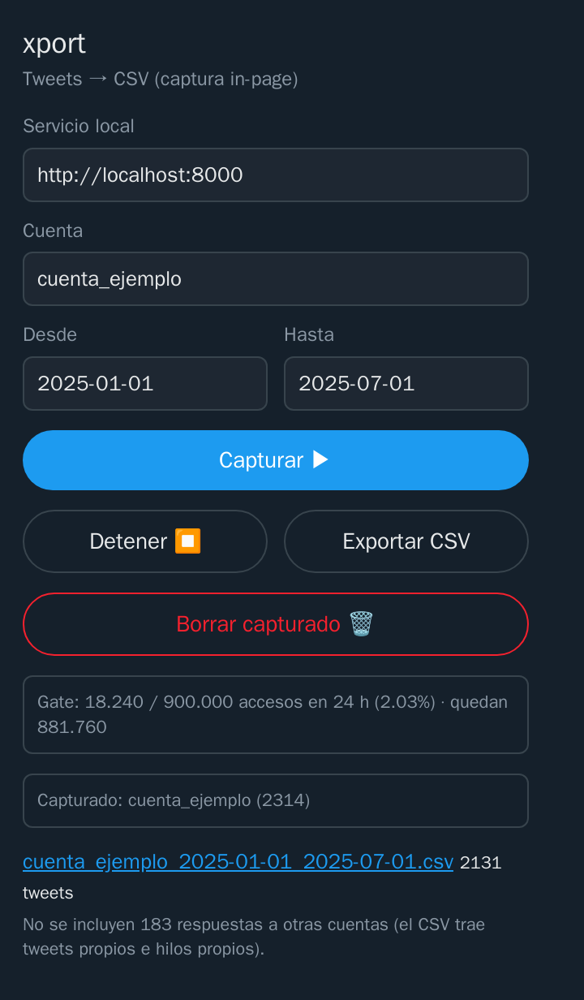

# xport: X accounts' tweets to CSV

[Español](README.md)

Downloads the tweets of one or more X accounts between two dates and writes one CSV per account. You use it from a
Chrome or Firefox extension that hands what it captures to a service running on your computer.

**It cannot cross the limit in X's terms.** X's terms fine anyone who accesses more than a million posts in any 24-hour
period, so xport counts every post the browser sees, including quoted tweets and the retweets it later drops, and stops
at 900,000 within any 24-hour window. If the service cannot count what is being captured, the capture does not start,
or it stops.


## Status

In-browser capture works against x.com: it opens the account's search, scrolls it by itself, carries on when X cuts it
short and picks up where it left off. Since November 11 there is an installer for Linux that brings its own Python
and puts xport in the applications menu (see [Install](#install)). The CSV has these columns:

| Column | Contents |
|---|---|
| `account` | the account handle, in lowercase |
| `created_at` | date and time of the tweet, ISO 8601 in UTC |
| `content` | the full text, long tweets included |
| `links` | the tweet's external URLs (`expanded_url`), separated by spaces |
| `quoted_tweet_id`, `quoted_tweet_url` | the quoted tweet, if any |

Quote tweets and the account's own threads are in. Retweets and the account's replies inside other people's
conversations are left out; the export says how many replies it left out. If a tweet was edited and you capture it
again, the latest version is kept.

Without a browser there are two ways. With a regular X account it has been blocked since June 2026: x.com changed how
it signs requests and twscrape can no longer do it. With the [official X API](#with-the-official-api), which is paid,
it is implemented but **has not been tried against the real API**: it was built from X's documentation and made-up
responses. The capture cut-offs from 6 November 2026 and the queue from 10 November were tried against x.com on 10
November, with Chrome without a window; the local page and the notifications have not been tried in a browser yet. That
same afternoon X started answering 403 to anything that presents itself as `HeadlessChrome`, so the service's own
Chrome now runs inside cage.

## Everyday use: the page

With the service running, `http://localhost:8000/` is xport's page, in English or Spanish like the rest of xport;
with the installer, the «xport» shortcut opens it. It opens in your usual browser and handles several accounts at
once:

1. **Accounts and dates:** one or more accounts, separated by commas or spaces. «From» and «To» are both
   included («from 2025-01-01 to 2025-12-31, inclusive»), and an empty «To» means today. There are shortcuts: last month,
   last year and a whole year. If the CSV is going to an Excel set to Spanish, tick «For Excel set to Spanish».
2. **Capture:** each account goes into the queue and they are captured one at a time (X throttles search per account,
   and in parallel it does not pay off). The service opens its own Chrome with the extension inside a virtual screen
   nobody sees, so you do not have to keep anything in view or touch the browser. The first time, the page offers «Log
   in to X», which opens a regular Chrome window with xport's profile; a separate account is better than your own. If X
   ends the session later, that window shows up by itself. As soon as you log in, the window closes by itself and the
   capture goes on. If you close it without logging in, or if the service
   cannot use its Chrome (see [Install](#install)), the extension in your browser takes the queue as before: it opens
   the search in a tab and **that tab has to stay in view** while it captures.
3. **Follow it:** each capture shows its state (queued, running, paused, done or stopped), how far back it got, how
   much of the range it covers, how many tweets it has and when the last page came in. «Cancel» takes it off the
   queue; what was already stored stays.
4. **The CSV:** when one finishes, the service builds its CSV by itself and says so with a system notification, which
   on Linux opens the file with a click. The link stays on the page. If the whole range ends without a single tweet,
   it looks the account up on X and says why: it doesn't exist, it's suspended, it's protected, it blocked the X
   account xport captures with, or it exists and is public but posted nothing in those dates (or X hides it from
   search). If it stops (the cap,
   the service, a change on x.com), the notification says why.

Below, the page shows the cap: what was seen in the last 24 hours and a per-day summary of what was seen before, which
is only history and does not count towards the cap.

## Everyday use: the popup

Once it is installed (see [Install](#install)), everything happens in the extension's popup:



1. **Open the popup:** click the xport icon. At the top it shows how many accesses the cap has counted in the last 24
   hours and how many are left.
2. **Fill it in:** the account without `@`, and «From» and «To» as `YYYY-MM-DD`. «From» is included; «To» is
   not.
3. **Capture:** «Capture ▶» puts the account in the same queue as the page and, if nothing else is running, opens X's
   search in a new tab and scrolls it by itself. You can close the popup. When it finishes, the service builds the CSV
   and says so with a notification, as with the page. If X stops
   returning results before the start date, the extension narrows the range and searches again until the whole range is
   covered. «Stop ⏹» stops it. **That tab has to stay in view:** if you switch to another tab or minimize the
   window, the capture pauses (the popup says so) and carries on by itself when you come back.
4. **Export:** open the popup again and press «Export CSV». A link to the file appears, with how many tweets it has.
   If you will open it in an Excel set to Spanish (or any locale that uses the comma as decimal separator), tick «For
   Excel set to Spanish» first: the CSV comes out separated by `;` and with the BOM Excel needs to read accents. The
   popup remembers the box.
5. **Carry on another day:** if X throttled the search, come back later and press «Capture ▶» with the same dates. It
   continues from the oldest tweet you already have, without asking again for what it downloaded.

**It is private.** The extension uses the X session already open in your browser: your cookies never leave it. What it
captures goes to the local service, which only listens on your computer, and stays in your xport data folder:
`~/.local/share/xport` on Linux, `%LOCALAPPDATA%\xport` on Windows and `~/Library/Application Support/xport` on macOS.
It is not sent anywhere else. «Delete captured 🗑» deletes
what was captured for one account; the cap's ledger is never deleted. Capture with an X account you can afford to lose:
X may limit accounts that download many tweets.

For now it only captures through X's search, which stalls at about a thousand results and allows about 50 searches
every 15 minutes per X account. When a search stalls, the next one starts at the second of the oldest tweet it loaded,
so a day with many tweets comes out whole. When the searches run out, the capture shows «Waiting for X»
until the time X gives and then carries on by itself from where it was.

If the popup says it will not start because the service does not answer, start the service (see [Usage](#usage)) or
install the automatic start (see [Install](#install)). If it says the cap is full, wait: the popup shows how much is
left. If it says x.com changed the data format, the service could not read most of the tweets that came in and stopped
the capture so you are not left with an empty CSV: you need a new version of xport, and the service log has an example.

## Install

### With the installer (Linux)

The package brings its own Python: you do not need to install Python, uv or Node. You do need Chrome, Chromium or Edge
and [cage](https://github.com/cage-kiosk/cage), the invisible screen xport's Chrome runs in (`sudo pacman -S cage` on
Arch, `sudo apt install cage` on Debian and Ubuntu), because X answers 403 to Chrome in `--headless` mode.

1. **Build the package** (it is not published yet): in the repository folder, `bash deploy/extension-build.sh` and then
   `uv run python deploy/bundle/build.py`. It ends up in `dist/bundle/xport-<version>-linux-x86_64.tar.gz`.
2. **Install it:** `tar -xzf xport-<version>-linux-x86_64.tar.gz` and `./xport/install.sh`. It copies xport to
   `~/.local/lib/xport`, adds it to the applications menu and as the `xport` command in `~/.local/bin`, says whether
   something is missing (with the command that installs it on your distribution) and opens the page. It does not ask
   for a password.
3. **The first time**, the page offers «Log in to X»: it opens a regular Chrome window with xport's profile. A separate
   X account is better than yours. You only do it once.

After that, xport opens from the applications menu or with `xport` in a terminal: it starts the service if it is not
running and opens the page. `xport stop` closes it, `xport status` tells whether it is running and `xport check` tells
whether everything it needs is there. To update, install the new package on top. To uninstall,
`~/.local/lib/xport/uninstall.sh`; your data (the cap's ledger, the tweets, the CSVs and the X session) stays in
`~/.local/share/xport`.

On Windows and macOS the package is built in CI (a `.zip` with `install.cmd` and an `xport.app` to drag to
Applications), but it has not been tried on those systems yet, and there xport cannot capture without a window yet: the
capture is made by the extension loaded in your browser, with the tab in view.

### From the source

You need [uv](https://docs.astral.sh/uv/), which brings the right Python (3.12, pinned in `.python-version`), and
rootless [Podman](https://podman.io) to build the extension without installing Node. With Node 22 you can also build it
without Podman. To capture with no window on Linux you need Chrome, Chromium or Edge and
[cage](https://github.com/cage-kiosk/cage) (`sudo pacman -S cage` on Arch, `sudo apt install cage` on Debian and
Ubuntu): it is the virtual screen xport's Chrome runs in. X answers 403 to Chrome in `--headless` mode, so without cage
the capture goes back to a tab in your browser. For now, the same on Windows and macOS.

1. **Get the code:** on GitHub, «Code» → «Download ZIP», or `git clone` this repository.
2. **Set up the service:** in the repository folder, `uv sync`.
3. **Build the extension:** `bash deploy/extension-build.sh`. It ends up in `extension/dist/`.
4. **Load it in your browser:** see below, for yours.
5. **Automatic start (optional):** with the native messaging host, the browser starts the service when it opens and
   stops it when it closes. Install it once with `bash deploy/native-host/install-linux.sh` (Firefox) or
   `bash deploy/native-host/install-linux.sh --chrome` (Chrome, Chrome Beta or Chromium). For a Windows browser with the service in
   WSL, and to diagnose problems, see [deploy/native-host/README.en.md](deploy/native-host/README.en.md).

#### In Chrome

1. Open `chrome://extensions` and turn on «Developer mode», at the top right.
2. Click «Load unpacked» and choose the `extension/dist/chrome-mv3` folder.

#### In Firefox

1. Open `about:debugging` and choose «This Firefox».
2. Click «Load Temporary Add-on…» and choose the `extension/dist/firefox-mv2/manifest.json` file.

Firefox removes temporary add-ons when it closes: you have to load it again every time you open it.

## Usage

Start the service in one of these ways. `fastapi dev`, the automatic start and `tweet-extractor` share the data folder
and the cap's ledger, whatever folder they are run from. The first time, they move there whatever an earlier version
left in the repository's `data/` folder (they move it, not copy it, so there are never two ledgers). The compose is for
CI and deployment: it has its own ledger, in a Podman volume. If an xport already answers on `localhost:8000` or
`localhost:8080`, the service does not start and says why, because two services would keep two ledgers.

```sh
uv sync
uv run fastapi dev src/tweet_extractor/service/app.py
cp .env.example .env && podman compose -f deploy/compose.yaml up --build
uv run tweet-extractor capture --account nasa,esa --since 2025-01-01 --until 2026-01-01
uv run tweet-extractor extract --account <account> --since 2025-01-01 --until 2026-01-01
```

- `fastapi dev` starts the service on `http://localhost:8000`, the address the extension uses unless you tell it
  otherwise. It keeps everything in the data folder. It is what the automatic start runs too.
- `podman compose`, for CI and deployment, starts it in Alpine containers, behind nginx, on `http://localhost:8080`, which only listens on your
  computer. In the popup, put that address in the service field. It needs the `.env`, even if it is the empty copy of
  `.env.example`. The data and the cap's ledger live in two separate volumes. After a reboot it comes back by itself
  only if `podman-restart.service` is enabled (`systemctl --user enable podman-restart.service`).
- `tweet-extractor capture` queues captures for the extension, one per account (`--account` repeats or takes several
  separated by commas; `--excel` for an Excel set to Spanish). The browser with xport open takes them; progress and
  the CSVs are on the page.
- `tweet-extractor extract` downloads tweets from the server, without a browser: with the official API (see below) or with the
  cookies of an X account, which has been blocked since June 2026 and fails with an error that says so. `--since` is
  included and `--until` is not (UTC days). Also: `--out-dir` (by default, `csv/` in the data folder), `--subwindow-days`, `--encoding` (`utf-8-sig` adds the
  BOM Excel expects) and `--delimiter` (`;` for an Excel set to a locale that uses the comma as decimal separator). If
  it stops, running it again skips the stretches it already finished.
- Language: the popup and the page pick English or Spanish from the browser and have a selector at the top, which is
  remembered. The CLI and the notifications follow the system language; `--lang en` or `--lang es` changes it in the
  CLI, and `XPORT_LANG` in the service. The CSV is the same in both languages.

### With the official API

If you have an X app with paid API access, set `PROVIDER_BACKEND=official` and the Bearer token in
`X_API_BEARER_TOKEN` in `.env`, and use `tweet-extractor` or `POST /jobs`. It uses full-archive search, which has no
ceiling like the ~3,200 tweets of an account's timeline, and asks for no retweets and no expansions, so you do not pay
for what gets dropped. It makes at most one request per second and, if X says the limit was hit, waits as long as X
says.

Every tweet read is billed: in November 2026, X listed 0.005 dollars per post (5 dollars per thousand) and a cap of
3 million a month. If your plan does not include full-archive search, X answers 403 and xport says so. **It has not
been tried against the real API**: if something fails, the error carries what X answered.

The service answers these requests:

| Request | What it does |
|---|---|
| `GET /` | xport's page |
| `GET /healthz` | says whether the service is alive and that it is xport |
| `GET /gate` | cap usage in the last 24 hours, what is left, the cap and the window |
| `POST /ingest` | stores the pages the extension captured and records their accesses |
| `POST /progress` | the oldest stored tweet of an account in a range: where capture resumes |
| `POST /export`, `GET /exports/{file}` | builds and downloads the CSV of a captured range (optional `encoding` and `delimiter`) |
| `POST /reset` | deletes what was captured for an account (the cap's ledger is never touched) |
| `POST /captures`, `GET /captures` | queues one capture per account; lists the latest, with their progress |
| `POST /captures/next` | the capture the extension has to do (taken from the queue); 204 if there is none or the cap is full |
| `POST /captures/{id}/state` | what the extension reports (running, paused, done, stopped) or a cancellation |
| `GET /captures/{id}/csv` | the CSV of a finished capture |
| `GET /gate/days` | what was seen per day over the last 30 days with activity (does not count towards the cap) |
| `POST /jobs`, `GET /jobs`, `GET /jobs/{id}`, `GET /jobs/{id}/csv/{account}` | server-side downloads (blocked) |

Configuration lives in the repository's `.env`, which git ignores; [`.env.example`](.env.example) lists every variable
with comments. It is always read from the repository, even when the CLI runs from another folder. In-browser capture
needs none of them: it uses the browser's session. Relative paths hang from the data folder.

| Variable | Purpose | Default |
|---|---|---|
| `PROVIDER_BACKEND` | where the server downloads from: `twscrape` or `official` | `twscrape` |
| `X_AUTH_TOKEN`, `X_CT0` | cookies of a separate X account (twscrape) | empty |
| `X_API_BEARER_TOKEN` | Bearer token for the official API (paid) | empty |
| `XPORT_DATA_DIR` | the data folder (absolute path) | your system's, see above |
| `AUDIT_DB_PATH` | the cap's ledger, separate from the data | `audit/ledger.db` |
| `DATA_DB_PATH`, `ACCOUNTS_DB_PATH` | tweets; twscrape accounts | `tweets.db`, `accounts.db` |
| `CSV_DIR`, `CAPTURES_DIR` | CSVs of server-side downloads and of captures | `csv`, `captures` |
| `QUEUE_DB_PATH` | the capture queue | `queue.db` |
| `XPORT_NOTIFY` | system notification when a capture finishes or stops | `true` |
| `CORS_ALLOW_ORIGINS` | JSON list of allowed origins (the extension does not need it) | `[]` |
| `ALLOWED_HOSTS` | hosts the service answers to (guards against DNS rebinding) | `["localhost","127.0.0.1"]` |
| `PAGE_SIZE`, `SUBWINDOW_DAYS` | page size and days per search stretch (server) | `20`, `7` |

The cap (900,000) and the window (24 hours) are deliberately not in this list: they are constants in the code and no
variable changes them.

X's search is `from:<account> since_time:<from> until_time:<to>`, in UTC seconds: the start day is included in full
and the end day is not (`since:` and `until:` take days in the searcher's time zone). Of
the replies, the CSV keeps those that hang from a conversation the same account started. If that first tweet falls
outside the range and was never captured, its replies inside the range are left out too.

## Tests

```sh
uv run pytest
uv run ruff check . && uv run ruff format --check .
uv run mypy src
```

They run offline, with made-up X responses. The cap's tests force the two things that matter: that it blocks when
there is no room and that it waits until the oldest access leaves the window. The extension's tests (vitest) run inside
`bash deploy/extension-build.sh`, between the type check and the build; among other things they cover when the crawl
is cut. **Never commit `.env`:** it holds session cookies. What was captured does not live in the repository but in
the data folder.

## How it is built

Continuous integration (`.github/workflows/ci.yml`) runs ruff, mypy and the tests, builds the service image and
both versions of the extension, with its tests, with Podman, and builds the installable package on Linux, Windows and
macOS, with a smoke test. By hand:

```sh
podman build -f deploy/Containerfile -t xport .
bash deploy/extension-build.sh
```

The image comes from `deploy/Containerfile`; the extension ends up in `extension/dist/chrome-mv3` and
`extension/dist/firefox-mv2`. No container mounts the repository: the extension is copied out with `podman cp`. Some
decisions:

- Capture happens in the browser, not on the server. Since x.com changed how it signs requests, in June 2026, fetching
  from outside means rebuilding that signature every few weeks. The browser computes it by itself, and the shape of the
  responses did not change, so the rest of the code works as before.
- The cap is 900,000 and not a million, to leave a margin for any doubt about what counts as an access. The window is
  rolling, because a per-calendar-day counter would let almost two million through between 11 pm and 1 am. Accesses are
  counted, not tweets stored, without deduplication, because counting too many is safe and counting too few is not.
- Server-side downloads reserve, before each request, an upper bound of what it can bring (three times the page size,
  for the quoted tweets) and wait if it does not fit. What the browser captures has already happened, so it is recorded
  afterwards, and that is why the extension cuts the crawl when the service cannot record it.
- The cap's ledger is a separate SQLite file, so it survives deleting the tweets. Each check and its write run in a
  `BEGIN IMMEDIATE` transaction, so two processes sharing the ledger cannot both get through.
- The official API uses full-archive search and not the account's timeline, which only reaches the latest ~3,200
  tweets and would leave an old range out. It asks for no expansions: the quoted tweet's id already comes in the
  response, and X bills expansions from 22 November 2026.
- The service only answers requests addressed to `localhost` or `127.0.0.1`. It only listens on your computer, but a
  web page using DNS rebinding could reach it under its own domain.
- Any site you open can send requests to `localhost` from your browser. So the ones that change something (queueing,
  cancelling, deleting) have to come from the page itself, from the extension or from a program without a browser,
  like the CLI: those carrying another site's `Origin` get 403.
- The queue goes one account at a time, because X throttles search per X account and in parallel it does not pay
  off. It lives in SQLite in the data folder, so it survives a restart.
- Only `mappers/` interprets X's responses; the extension does not read them. When x.com changes the shape, it is fixed
  in one place, and a change the mapper does not understand gives an error, not an empty CSV.
- The CSV defaults (UTF-8 without BOM, comma, everything quoted, UTC, `<account>_<from>_<to>.csv`) have been settled
  since June 2026. The same range rewrites its file and different ranges live side by side.
- The installable package (`deploy/bundle/build.py`) brings the portable CPython from python-build-standalone that uv
  downloads, with the exact dependencies of `uv.lock` installed inside: whoever uses it installs nothing but Chrome and
  cage. It is built on each system because some dependencies come compiled (pydantic-core, uvloop). The installer
  (`installer.py`) is run by that same Python, so its messages come in both languages and pytest tests it.
- The image is Alpine, multi-stage, with no browser: Chromium on musl is not worth it. If one is ever needed, it goes
  in a separate image.
- Only FastAPI handles CORS; nginx adds no headers, so they are never duplicated.
- The extension is built with [WXT](https://wxt.dev): one codebase for Chrome (MV3) and Firefox (MV2).
- The images come from `docs/img/generar.py` (`python3 docs/img/generar.py`): the logo as a vector, the diagrams and
  the social card in Spanish and English, so they are fixed in code and not in a drawing program. The extension's
  icons come from the logo. `docs/img/popup.png` is the real popup with example data.
- The look is X's in black ("Lights out"), with a touch of its own taken from the logo: the blue arrow corner marks
  what comes out, and the monospaced type is for data.
- The project page (`docs/index.html` and `docs/en/`) is published by GitHub Pages from the `docs/` folder of `main`,
  with no build step.


The code is layered, and each layer only knows the one below:

```
providers/     where the data comes from, behind TweetProvider (twscrape, official API)
mappers/       X responses → domain model (the only place that interprets them)
domain/        Tweet and TweetLink (pydantic v2)
compliance/    the cap's ledger (SlidingWindowGate) and GatedProvider
storage/       data SQLite (deduplicated, finished stretches) and streaming CSV export
service/       FastAPI: captures, export, cap status, server-side downloads
cli.py         the command line (Typer)
launcher.py    the xport command behind the shortcut: starts the service and opens the page
installer.py   the package's installer
extension/     extension for Chrome and Firefox (WXT)
```

The decisions with their history, and what is left, are in [docs/PLAN.en.md](docs/PLAN.en.md).

## License

[MIT](LICENSE).
