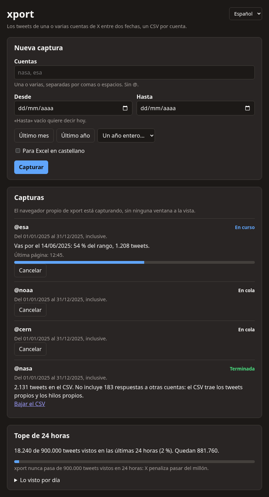

<div align="center">


# xport

**Los tweets de cualquier cuenta de X, entre dos fechas, en un CSV.**<br>
[English](README.en.md) · [Sitio](https://bafif.github.io/xport/) · [Instalar](#instalar) · [Cómo se usa](docs/USAGE.md)

</div>

Escribís una o varias cuentas y un rango de fechas. xport recorre la búsqueda de X por vos y te deja un CSV por cuenta,
con la fecha, el texto completo, los links y el tweet citado. Usa una sesión común de X: no hace falta una clave de API
ni pagar nada.

<p align="center"></p>

## Por qué xport

- **Varias cuentas de una vez.** Las cargás en la página de xport, entran a una cola y salen una por una, cada una con
  su CSV y una notificación cuando termina.
- **Sin ventanas en el medio.** En Linux, xport captura con su propio Chrome en una pantalla invisible: seguís usando
  la computadora como si nada.
- **Rangos largos, completos.** X corta cada búsqueda en unos mil resultados y limita cuántas se pueden hacer. xport
  sigue desde el último tweet que vio, espera cuando X lo pide y retoma solo, aunque cierres todo.
- **Nunca pasa el tope de X.** Los términos de X castigan leer más de un millón de posts en 24 horas. xport cuenta
  cada post que ve y frena en 900.000. Ese tope está fijo en el código: ninguna opción lo sube.
- **Lo tuyo queda en tu computadora.** El servicio escucha solo en tu equipo y no manda nada a ningún servidor.
- **Listo para Excel.** UTF-8, una casilla para el Excel en castellano y la interfaz en castellano o en inglés.

## Qué trae el CSV

| Columna | Qué tiene |
|---|---|
| `account` | el handle de la cuenta, en minúsculas |
| `created_at` | fecha y hora del tweet, ISO 8601 en UTC |
| `content` | el texto completo, también el de los tweets largos |
| `links` | las URLs externas del tweet, separadas por espacio |
| `quoted_tweet_id`, `quoted_tweet_url` | el tweet citado, si lo hay |

Entran los quote tweets y los hilos de la propia cuenta. Quedan afuera los retweets y las respuestas en conversaciones
ajenas.

## Instalar

Hace falta Google Chrome (o Chromium o Microsoft Edge). Conviene capturar con una cuenta de X aparte de la tuya.

### Con el instalador

Bajá el de tu sistema desde la [última versión](https://github.com/bafif/xport/releases/latest). Trae todo lo que
xport necesita, incluido su propio Python.

| Sistema | Archivo | Cómo se instala |
|---|---|---|
| Linux | `xport-<versión>-linux-x86_64.tar.gz` | `tar -xzf xport-*-linux-x86_64.tar.gz && ./xport/install.sh` |
| Windows | `xport-<versión>-windows-x86_64.zip` | descomprimilo y hacé doble clic en `xport\install.cmd` |
| macOS | `xport-<versión>-macos-arm64.tar.gz` | abrilo y arrastrá `xport.app` a Aplicaciones |

En Linux, además, hace falta [cage](https://github.com/cage-kiosk/cage), la pantalla invisible donde corre el Chrome de
xport: `sudo apt install cage` en Debian y Ubuntu, `sudo pacman -S cage` en Arch. El instalador avisa si falta.

En Windows y macOS hay un paso más: cargar la extensión de xport en tu Chrome una sola vez
([cómo](docs/INSTALL.md#la-extensión-en-tu-navegador)). Si la versión que bajaste no trae el instalador de tu
sistema, se arma con unos pocos comandos ([cómo](docs/INSTALL.md#armar-el-instalador)).

### En Linux, desde la terminal

Con [uv](https://docs.astral.sh/uv/) y Node 26 instalados:

```sh
git clone https://github.com/bafif/xport && cd xport
(cd extension && npm ci && npm run build:chrome)
uv run python deploy/bundle/build.py
tar -xzf dist/bundle/xport-*-linux-x86_64.tar.gz -C dist/bundle && dist/bundle/xport/install.sh
```

Queda en el menú de aplicaciones y como el comando `xport`.

## Cómo se usa

1. **Abrí xport** desde el menú de aplicaciones (o con `xport` en la terminal). Se abre su página en tu navegador.
2. **La primera vez**, «Iniciar sesión en X» abre una ventana para entrar a X. Se hace una sola vez.
3. **Escribí las cuentas y las fechas** y apretá «Capturar». Cada cuenta avisa con una notificación cuando su CSV está
   listo, y el enlace queda en la página.

Todo el detalle, con el popup de la extensión y qué significa cada aviso, está en [Cómo se usa](docs/USAGE.md).

## Estado

- **Linux:** probado de punta a punta contra x.com, con el instalador y la captura sin ventana.
- **Windows y macOS:** el instalador se arma y arranca en la integración continua, pero todavía no se probó en esos
  sistemas. Ahí la captura la hace la extensión en tu Chrome, con la pestaña de X a la vista.
- **Sin navegador:** con la API oficial de X, que es paga, está implementado pero no se probó contra la API real. Con
  una cuenta común no anda: x.com cambió cómo firma los pedidos.

## Más documentación

- [Instalar](docs/INSTALL.md): cada sistema en detalle, armar el instalador, actualizar y desinstalar.
- [Cómo se usa](docs/USAGE.md): la página, el popup, los límites de X y qué significa cada aviso.
- [Referencia](docs/REFERENCE.md): la línea de comandos, la API oficial, la API del servicio y la configuración.
- [Cómo está hecho](docs/ARCHITECTURE.md): las capas, las decisiones de diseño, las pruebas y cómo desarrollar.
- [Plan](docs/PLAN.md): las reglas del proyecto y lo que falta.

## Licencia

[MIT](LICENSE).
