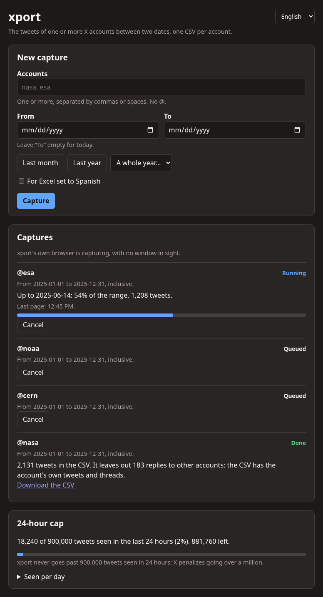
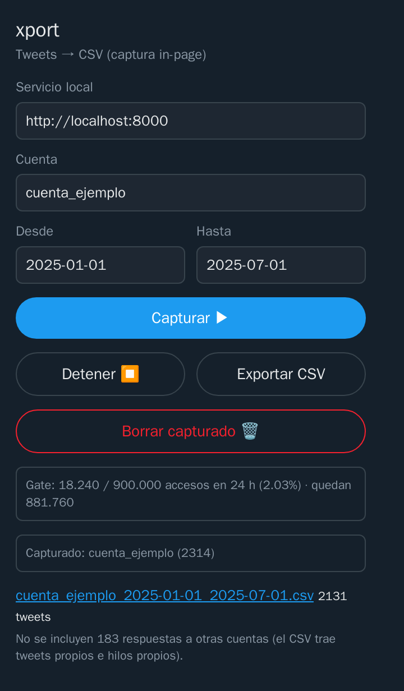

# How to use xport

[Español](USAGE.md) · [Back to the README](../README.en.md)

xport is used from its page, which opens in your browser. The extension also has a popup with the basics.

## The page

The «xport» shortcut opens it; with the service running, it is also at `http://localhost:8000/`. It handles several
accounts at once:

1. **Accounts and dates.** One or more accounts, separated by commas or spaces. «From» and «To» are both included
   (1 January to 31 December is the whole year), and an empty «To» means today. There are shortcuts: last month, last
   year and a whole year. If the CSV is going to an Excel set to Spanish, tick «For Excel set to Spanish».
2. **Capture.** Each account goes into a queue and they are captured one at a time, because X throttles search per
   account and in parallel it does not pay off.
   - On Linux with cage, the service opens its own Chrome with the extension on a screen nobody sees: you do not have
     to keep anything in view or touch the browser.
   - On Windows, on macOS or without cage, the capture is done by the extension in your browser: it opens the search
     in a tab and **that tab has to stay in view**. If you cover it, the capture pauses and carries on by itself when
     you come back.
3. **Follow it.** Each capture shows its state (queued, running, paused, waiting for X, done or stopped), how far back
   it got, how much of the range it covers, how many tweets it has and when the last page came in. «Cancel» takes it
   off the queue; what was already stored stays.
4. **The CSV.** When a capture finishes, the service builds its CSV and says so with a system notification (on Linux,
   a click opens the file). The link stays on the page. If it stops, the notification says why.

If the whole range ends without a single tweet, xport looks the account up on X and says why: it doesn't exist, it's
suspended, it's protected, it blocked the X account xport captures with, or it exists and is public but posted nothing
in those dates (or X hides it from search).

Below, the page shows the cap: what was seen in the last 24 hours and a per-day summary of what was seen before.

### The X session

The first time, the page offers «Log in to X»: it opens a Chrome window with xport's profile, you sign in with your
account and the window closes by itself. If X ends the session later, the window shows up again. If you close it
without logging in, the queue is taken by the extension in your browser, with your usual session.

## The extension's popup

1. **Open it** with the xport icon. At the top it shows how many accesses the cap has counted in the last 24 hours and
   how many are left.
2. **Fill in** the account without `@` and the dates as `YYYY-MM-DD`. In the popup, «From» is included and «To» is
   not.
3. **«Capture ▶»** puts the account in the same queue as the page. If nothing else is running, it opens X's search in
   a new tab and goes through it by itself. You can close the popup. «Stop ⏹» stops the capture.
4. **«Export CSV»** builds the file and shows the link, with how many tweets it has. «For Excel set to Spanish» is
   remembered.
5. **«Delete captured 🗑»** deletes what was captured for that account, to start it from scratch.

## X's limits, and what xport does

- **Each search stalls at about a thousand results.** The next one starts at the second of the oldest tweet it loaded,
  so a day with many tweets comes out whole.
- **About 50 searches every 15 minutes per X account.** When they run out, the capture shows «Waiting for X» until the
  time X gives and carries on by itself from where it was.
- **Blank loads** (the spinner or «Something went wrong»): xport retries, waiting a little longer each time. It does
  not take them as the end of the data.
- **Resuming:** if you close everything in the middle of a capture, next time it continues from the oldest tweet you
  already had, without asking again for what it downloaded.

## What goes into the CSV

- One per account and range, named `<account>_<from>_<to>.csv`. The same range rewrites its file; different ranges live
  side by side.
- UTF-8, comma-separated, everything quoted and dates in UTC. With «For Excel set to Spanish» it comes out separated by
  `;` and with the BOM Excel needs to read accents.
- Quote tweets (with the quoted tweet's id and link) and the account's own threads are in. Retweets and the replies the
  account wrote in other people's conversations are left out; the export says how many replies it left out, which is
  why the CSV can have fewer tweets than were captured.
- If a tweet was edited and you capture it again, the latest version stays.
- The columns are in the [README](../README.en.md#what-the-csv-has). They are the same in both languages.

## The 24-hour cap

X's terms penalize accessing more than a million posts in any 24-hour period. xport counts every post it gets to see,
including quoted tweets and the retweets it later drops, and stops at 900,000 within any 24-hour window. If the
service cannot count what is being captured, the capture does not start or stops.

There is a single ledger for the cap, whatever X account you capture with, and it lives apart from the tweets:
deleting what was captured does not reset it.

## Privacy

- The X session stays in xport's profile (or in your browser, if the extension captures) and the cookies never leave
  it.
- The service only listens on your computer and only answers requests addressed to it.
- What is captured stays in your data folder: `~/.local/share/xport` on Linux, `%LOCALAPPDATA%\xport` on Windows and
  `~/Library/Application Support/xport` on macOS. It is not sent anywhere else.

## Language

The page and the popup come in English or Spanish depending on your browser, and have a selector at the top that is
remembered. Notifications and the command line follow the system language.

## If something does not work

| Message | What is going on and what to do |
|---|---|
| «couldn't reach the service» | the service is not running: open xport from its shortcut |
| «Waiting for X» | X throttled the searches for a while; the capture carries on by itself at the time given |
| the cap is full | 900,000 were reached in the last 24 hours; the page shows how long until it frees up |
| «x.com changed the shape of its data» | xport did not understand what X sent and stopped so you are not left with an empty CSV: you need a new version |
| the capture is «Paused» | the X tab in your browser got covered; bring it back into view |

For installation issues, see [Install](INSTALL.en.md#if-something-does-not-work).
