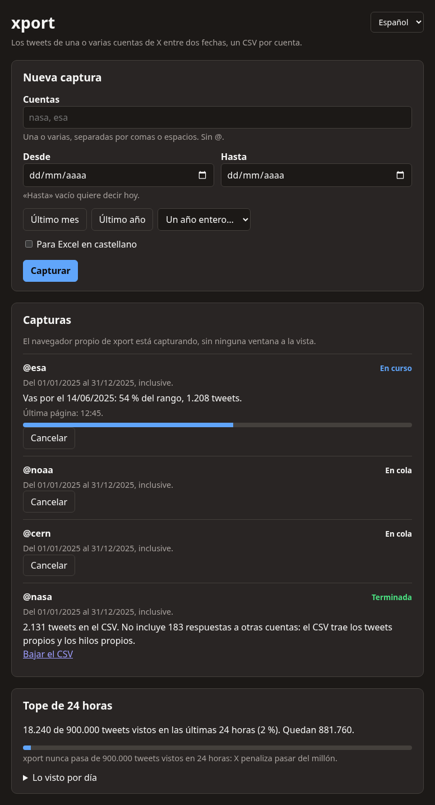
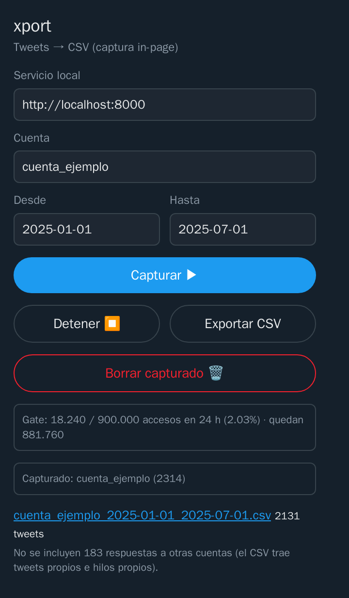

# Cómo se usa xport

[English](USAGE.en.md) · [Volver al README](../README.md)

xport se usa desde su página, que se abre en tu navegador. La extensión tiene además un popup con lo básico.

## La página

El acceso directo «xport» la abre; con el servicio andando, también está en `http://localhost:8000/`. Sirve para varias
cuentas a la vez:

1. **Cuentas y fechas.** Una o varias cuentas, separadas por comas o espacios. «Desde» y «Hasta» entran los dos (del
   1/1 al 31/12 es el año entero), y «Hasta» vacío quiere decir hoy. Hay atajos: último mes, último año y un año entero.
   Si el CSV va a un Excel configurado en castellano, marcá «Para Excel en castellano».
2. **Capturar.** Cada cuenta entra a una cola y se capturan de a una, porque X frena la búsqueda por cuenta y en
   paralelo no rinde.
   - En Linux con cage, el servicio abre su propio Chrome con la extensión en una pantalla que nadie ve: no tenés que
     dejar nada a la vista ni tocar el navegador.
   - En Windows, en macOS o sin cage, la captura la hace la extensión de tu navegador: abre la búsqueda en una pestaña
     y **esa pestaña tiene que quedar a la vista**. Si la tapás, la captura se pone en pausa y sigue sola cuando
     volvés.
3. **Seguirla.** Cada captura dice su estado (en cola, en curso, en pausa, esperando a X, terminada o cortada), hasta
   qué día llegó, qué parte del rango cubre, cuántos tweets lleva y a qué hora entró la última página. «Cancelar» la
   saca de la cola; lo que ya se guardó queda.
4. **El CSV.** Cuando una captura termina, el servicio arma su CSV y avisa con una notificación del sistema (en Linux,
   un clic abre el archivo). El enlace queda en la página. Si se corta, la notificación dice por qué.

Si el rango entero termina sin un solo tweet, xport mira la cuenta en X y dice por qué: no existe, está suspendida, es
protegida, bloqueó a la cuenta con que captura xport, o existe y es pública pero no escribió en esas fechas (o X la
oculta de la búsqueda).

Abajo, la página muestra el tope: lo visto en las últimas 24 horas y un resumen por día de lo visto antes.

### La sesión de X

La primera vez, la página ofrece «Iniciar sesión en X»: abre una ventana de Chrome con el perfil de xport, entrás con
tu cuenta y la ventana se cierra sola. Si X cierra la sesión más adelante, la ventana vuelve a aparecer. Si la cerrás
sin iniciar sesión, la cola la toma la extensión de tu navegador, con tu sesión de siempre.

## El popup de la extensión

1. **Abrilo** con el ícono de xport. Arriba muestra cuántos accesos lleva el tope en las últimas 24 horas y cuántos
   quedan.
2. **Completá** la cuenta sin `@` y las fechas en formato `AAAA-MM-DD`. En el popup, «Desde» entra y «Hasta» no.
3. **«Capturar ▶»** pone la cuenta en la misma cola que la página. Si no hay otra en curso, abre la búsqueda de X en
   una pestaña nueva y la recorre sola. Podés cerrar el popup. «Detener ⏹» corta la captura.
4. **«Exportar CSV»** arma el archivo y muestra el enlace, con cuántos tweets tiene. «Para Excel en castellano» queda
   recordado.
5. **«Borrar capturado 🗑»** borra lo capturado de esa cuenta, para empezarla de cero.

## Los límites de X, y qué hace xport

- **Cada búsqueda se frena en unos mil resultados.** La siguiente arranca en el segundo del tweet más viejo que cargó,
  así que un día con muchos tweets sale entero.
- **Unas 50 búsquedas cada 15 minutos por cuenta de X.** Cuando se acaban, la captura queda «Esperando a X» hasta la
  hora que X indica y sigue sola desde donde iba.
- **Cargas en blanco** (la ruedita o «Something went wrong»): xport reintenta, cada vez esperando un poco más. No las
  toma como el final de los datos.
- **Retomar:** si cerrás todo a mitad de una captura, la próxima vez sigue desde el tweet más viejo que ya tenías, sin
  volver a pedir lo bajado.

## Qué entra en el CSV

- Uno por cuenta y por rango, llamado `<cuenta>_<desde>_<hasta>.csv`. El mismo rango reescribe su archivo; rangos
  distintos conviven.
- UTF-8, separado por comas, todo entre comillas y las fechas en UTC. Con «Para Excel en castellano» sale separado por
  `;` y con el BOM que Excel necesita para leer los acentos.
- Entran los quote tweets (con el id y el link del citado) y los hilos de la propia cuenta. Quedan afuera los retweets
  y las respuestas que la cuenta escribió en conversaciones ajenas; el export dice cuántas respuestas dejó afuera, por
  eso el CSV puede tener menos tweets que los capturados.
- Si un tweet se editó y lo volvés a capturar, queda la última versión.
- Las columnas están en el [README](../README.md#qué-trae-el-csv). Son las mismas en los dos idiomas.

## El tope de 24 horas

Los términos de X castigan acceder a más de un millón de posts en cualquier período de 24 horas. xport cuenta cada post
que llega a ver, también los citados y los retweets que después descarta, y frena en 900.000 dentro de cualquier
ventana de 24 horas. Si el servicio no puede contar lo que se captura, la captura no arranca o se corta.

Hay un solo registro del tope, sin importar con qué cuenta de X captures, y vive aparte de los tweets: borrar lo
capturado no lo pone en cero.

## Privacidad

- La sesión de X queda en el perfil de xport (o en tu navegador, si captura la extensión) y las cookies no salen de
  ahí.
- El servicio escucha solo en tu computadora y responde solo a pedidos dirigidos a ella.
- Lo capturado queda en tu carpeta de datos: `~/.local/share/xport` en Linux, `%LOCALAPPDATA%\xport` en Windows y
  `~/Library/Application Support/xport` en macOS. No se manda a ningún otro lado.

## Idioma

La página y el popup salen en castellano o en inglés según tu navegador, y tienen un selector arriba que queda
recordado. Las notificaciones y la línea de comandos siguen el idioma del sistema.

## Si algo no anda

| Aviso | Qué pasa y qué hacer |
|---|---|
| «no se pudo contactar al servicio» | el servicio no está corriendo: abrí xport desde su acceso directo |
| «Esperando a X» | X frenó las búsquedas un rato; la captura sigue sola a la hora indicada |
| el tope está lleno | se llegó a 900.000 en las últimas 24 horas; la página muestra cuánto falta para que se libere |
| «x.com cambió el formato de los datos» | xport no entendió lo que mandó X y cortó para no dejarte un CSV vacío: hace falta una versión nueva |
| la captura queda «en pausa» | la pestaña de X de tu navegador quedó tapada; volvé a mostrarla |

Para lo que es de la instalación, ver [Instalar](INSTALL.md#si-algo-no-anda).
